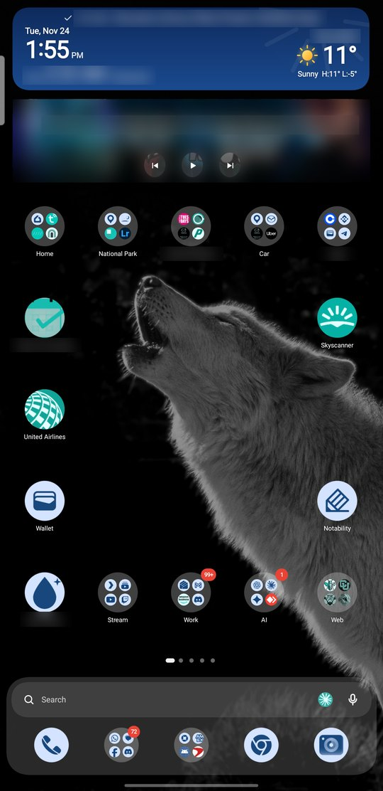

# Horizon

An Android home-screen launcher (`com.praiselab.horizon`): clock and agenda, live tiles, folders, widgets, an app drawer with search, and optional Microsoft To Do / calendar sign-in (you enter your own client ID; no secret ships in the app).



Download the APK from [my-apps releases](https://github.com/chahatdeep/my-apps/releases?q=horizon).

## Download

Get **Horizon 1.0** from the [my-apps releases](https://github.com/chahatdeep/my-apps/releases/tag/horizon-v1.0) ([Horizon-1.0.apk](https://github.com/chahatdeep/my-apps/releases/download/horizon-v1.0/Horizon-1.0.apk)). Open it on the phone, allow installs from your browser if Android asks, then press Home and pick Horizon as the default home app. More of my apps: [chahatdeep.github.io/my-apps](https://chahatdeep.github.io/my-apps).

## Build

No Gradle. From PowerShell:

```powershell
.\android\build.ps1
```

It copies `web/index.html` into the app's assets, compiles, and signs `Horizon.apk`. Signing uses a local keystore that is not in this repo; updates must be signed with the same key to install over an existing copy.

Requires Android 11 (API 30) or later.

## License

[MIT](LICENSE)
